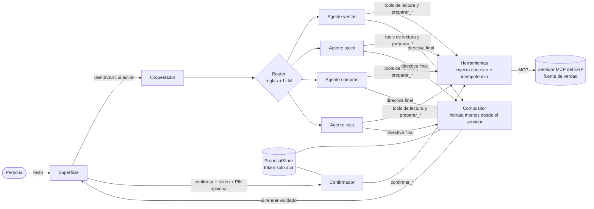

# agentic-erp-core

> **En la gestión, el agente propone y la persona decide.**

Framework (TypeScript) para agregarle una capa agéntica a un ERP sin dejar que el modelo toque dinero ni confirme nada por su cuenta.

[](https://github.com/alvarezleonardo/agentic-erp-core/actions/workflows/ci.yml)
[](LICENSE)
[](.nvmrc)
[](CHANGELOG.md)


La demo cuenta una idea: el modelo propone, pero no escribe ni pone montos; la persona decide. Una frase llega a la `ConfirmationCard` con el monto calculado por el servidor MCP, un supervisor confirma con su PIN (step-up, que viaja de la pantalla al servidor sin pasar por el modelo) y recién ahí se escribe en el ERP. Cada garantía del cierre se verifica en runtime. Corre offline con un LLM guionado: `npm run demo`.

## Por qué existe

Un agente que lee tu ERP es fácil; uno en el que se pueda confiar para mover dinero, no. Los principios de [ADR-001](docs/adr/ADR-001-principios.md) lo resuelven con mecanismos y pruebas, no con confianza en el modelo: las escrituras se parten en `preparar_*` y `confirmar_*` y solo la persona confirma, los montos los pone el servidor, el modelo nunca ve el token ni el PIN, y toda corrida termina en una directiva final. Con [ADR-002](docs/adr/ADR-002-un-orquestador.md), la cobertura de un ERP completo sale de un orquestador con agentes de dominio acotados, no de un enjambre que se delega trabajo entre sí.

*English summary:* a TypeScript framework to add an agent layer on top of any ERP exposed through MCP. One orchestrator with scoped agents (at most 15 tools each, never a swarm), a hybrid rules+LLM router, and a hard propose/confirm split: the model only calls `preparar_*` tools, the server computes every amount, confirmation tokens and PINs never reach the model, and every run ends in `render_ui`, `clarify` or `report_error`. Supervisor step-up (PIN and reason) travels from the screen to the server, never through the model. Ships with a synthetic ERP (sales, stock, purchases, cash), a terminal demo (`npm run demo`, offline, scripted LLM), a golden eval set (31 phrases) that runs offline with a scripted LLM and can also run against a real model with a spend cap, and security tests. Status: v0.1.0, MIT. Docs are in Spanish.

## Qué resuelve

Un agente que lee tu ERP es fácil. Uno en el que podés confiar para que prepare un pedido a un proveedor o un egreso de caja es otra cosa. Este núcleo fija las reglas que lo hacen seguro:

| Principio | Cómo se cumple |
|---|---|
| El agente propone, la pantalla muestra, la persona confirma | Las escrituras son pares `preparar_*` / `confirmar_*`. Solo el `Confirmador` llama a `confirmar_*`, y solo ante un `ui.action` de la persona. |
| El servidor pone los montos | El `Compositor` hidrata importes desde la salida de las tools y descarta lo que el modelo escriba en esos campos (`x-source`) o diga con cifras. |
| El modelo nunca ve el token ni el PIN | El token vive en el `ProposalStore`; al modelo le llega una vista sin secretos. El PIN va de la pantalla al servidor y no entra en las trazas. |
| Un orquestador, no un enjambre | Agentes de dominio con ≤15 tools que no se hablan entre sí (ver [ADR-002](docs/adr/ADR-002-un-orquestador.md)). |
| Router híbrido | Reglas en español primero; si no alcanzan, el modelo clasifica por llamada a función; si nada clasifica, se le pregunta a la persona. |
| Nunca queda en el aire | Toda corrida termina en `render_ui`, `clarify` o `report_error`, incluso si el modelo cae o se agota el presupuesto. |

Los principios completos están en [ADR-001](docs/adr/ADR-001-principios.md).

## Arquitectura



El modelo ve únicamente el camino superior. La flecha de confirmación sale de la pantalla, no del modelo.

## Estructura

```
packages/
  core/          router, AgentRunner, ProposalStore, Compositor, Confirmador, Orquestador, memoria, permisos, trazas
  llm/           interfaz, ScriptedProvider, presupuesto de gasto, adaptador de ejemplo (variables de entorno)
  mcp-contract/  tipos, JSON Schema, verificación de conformidad, kit de servidor (token, idempotencia, PIN) y CONTRACT.md
  mcp-client/    cliente MCP (stdio, HTTP, en memoria) y cliente compuesto
contracts/genui/ componentes genéricos versionados (JSON Schema)
examples/erp-sintetico/  ERP determinista (ventas, stock, compras, caja) + 4 agentes + reglas del router
evals/           31 frases doradas, runner y reporte
tests/           pruebas de seguridad de punta a punta
docs/adr/        decisiones de diseño
```

## Quickstart

Requiere Node 22 o superior.

```bash
npm install
npm run check        # typecheck + tests + evals
npm run demo         # egreso de caja con PIN de supervisor, offline
npm run eval         # 31 frases con ScriptedProvider, sin red ni claves
npm run ejemplo:servidor   # el ERP sintético como servidor MCP por stdio
```

Para correr contra un modelo real, copiá `.env.example` a `.env`, completá `LLM_BASE_URL`, `LLM_API_KEY` y `LLM_MODEL` (cualquier endpoint compatible con `/chat/completions`) y ejecutá `npm run eval -- --proveedor=openai`. El proveedor respeta un tope de gasto (`LLM_LIMITE_USD`). No hay claves en el repositorio.

Ejemplo mínimo (en memoria, sin red):

```ts
import { ScriptedProvider, llamada } from '@agentic-erp/llm';
import { crearDespliegue, contextoDe } from './examples/erp-sintetico/src/index.js';

const llm = new ScriptedProvider([
  llamada('preparar_movimiento_caja', { tipo: 'egreso', concepto: 'Limpieza', importe: '85' }),
  llamada('render_ui', { component: 'ConfirmationCard' }),
]);
const d = await crearDespliegue({ llm });
const sesion = d.orquestador.crearSesion(contextoDe('operador'));
const sobres = await sesion.texto('registrá un egreso de caja de 85 por limpieza');
// sobres incluye una ConfirmationCard con el total puesto por el servidor.
// Nada se escribió todavía: falta que la persona mande ui.action "confirmar".
```

## Conectar tu ERP

1. Exponé tu ERP como servidor MCP que cumpla [`CONTRACT.md`](packages/mcp-contract/CONTRACT.md) y comprobalo con `verificarConformidad(tools)`.
2. Definí tus agentes con `definirAgente` (prompt en español, ≤15 tools, sin `confirmar_*`).
3. Escribí las reglas del router para tu vocabulario.
4. Armá el `Orquestador` como en `examples/erp-sintetico/src/despliegue.ts`.
5. Sumá evals con tus frases reales.

## Modo directo

Una superficie que declara el protocolo 1.1 puede mandar `user.input` con `comando: { tool, args }` en vez de texto (un botón, un atajo, o el degradado cuando no hay modelo). El `Orquestador` ejecuta esa tool por `Herramientas` sin pasar por el LLM, con los mismos permisos, el mismo contexto inyectado y la misma idempotencia. `confirmar_*` se rechaza siempre (solo lo hace el `Confirmador` ante la persona) y un `preparar_*` por comando pasa por el camino de siempre: `ProposalStore` y `ConfirmationCard` hidratada, sin ejecutar nada. El resultado de una lectura se muestra con el componente que registre el integrador para esa tool (`componentesPorTool`) o, si no hay, `DetailCard` para un objeto y `DataTable` para una lista.

## Step-up

Una propuesta puede exigir más que el toque de la persona: `motivo` (texto obligatorio), `supervisor` (usuario y PIN de otra persona con rol superior) o `supervisor_y_motivo`. La `ConfirmationCard` declara qué pide (`step_up`), el PIN y el motivo viajan de la pantalla al servidor dentro de `confirmar_*` (`autorizacion`) y el PIN no entra al modelo ni a las trazas. `@agentic-erp/mcp-contract` incluye un `hashPin`/`verificarPin` de referencia (scrypt) para el servidor. Ver [`CONTRACT.md`](packages/mcp-contract/CONTRACT.md).

## Pruebas

- Pruebas unitarias y de integración por paquete.
- `tests/seguridad.test.ts`: el modelo nunca recibe token ni PIN (ni el nombre del campo), los montos salen del servidor, el modelo no puede confirmar, y el token y el PIN no quedan en las trazas.
- Evals dorados: 31 frases con plan del router, tools usadas y componente esperado; corren offline y son parte de `npm run check`.

## Resultados de evals

Los evals dorados (31 frases) se corren con `npm run eval` y escriben `evals/reportes/ultimo.md` (ignorado por git).

| Modelo | Aciertos del router | Plan correcto | Componente correcto | Costo de la corrida | Fecha |
|---|---|---|---|---|---|
| ScriptedProvider (offline, guionado) | 31/31 | 31/31 | 31/31 | USD 0 | 13/11/2026 |

Cómo leerla (cada columna cuenta frases sobre 31; el reporte también informa tools correctas y tokens de entrada y salida):

- **Aciertos del router**: el origen de la clasificación (reglas, modelo o sin clasificar) coincide con el esperado.
- **Plan correcto**: la lista de dominios que arma el router coincide con la esperada, en orden.
- **Componente correcto**: el componente del último `ui.render` del slot principal coincide con el esperado.
- **Costo de la corrida**: suma del costo estimado que informa el proveedor en esa corrida, con la tabla de precios configurada. Con el guion offline es USD 0; si el modelo no tiene precio configurado se informa «sin precio» en vez de un valor.

Cada columna se mide por separado y no cambia el criterio de acierto total, que además exige tools, sobres válidos y step-up. Con un modelo real el origen del router se informa pero no hace fallar la frase.

Las corridas contra modelos reales se agregan con `npm run eval -- --proveedor=openai`; el proveedor respeta el tope de gasto `LLM_LIMITE_USD`.

## Pendiente

- Superficie de referencia (cliente web) para los componentes de `contracts/genui`.
- Persistencia del `ProposalStore` para despliegues con varias instancias.
- Más ejemplos de dominio y evals contra modelos reales.

## Licencia

[MIT](LICENSE) (c) 2026 Leonardo Alvarez.
